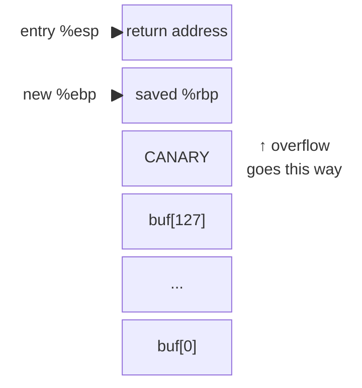
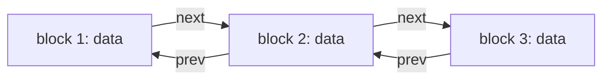
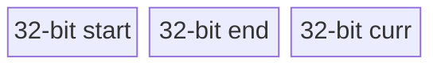

# Defending Buffer Overflows

Buffer overflows remain a popular attack path: in 2019 alone, five high-profile overruns hit popular apps, including [a WhatsApp vulnerability](https://blog.zimperium.com/whatsapp-buffer-overflow-vulnerability-under-the-scope/) ([survey](https://securityboulevard.com/2019/11/5-buffer-overflow-vulnerabilities-in-popular-apps/)). They also show how defenses and attacks evolve together. Raising the bar has been very worthwhile, even though no defense is perfect.

## The situation

The basic problem is buggy C code that writes past the end of a buffer or array. The ideal fix is a language that enforces bounds, such as Python or Java; retraining programmers and rewriting software is a huge effort but not impossible, as Microsoft's move to C# shows. C, however, runs too many valuable applications and libraries to abandon, new C code keeps being written, and the language's definition makes precise automatic bounds checking hard or impossible. A perfect programmer would check bounds every time, but no programmer is perfect. We therefore need defenses that make overflows harder to exploit in large, buggy C programs we don't fully understand.

## Classic stack overflows

A classic stack attack has two parts: it writes instructions into a buffer on the stack, then overwrites the saved return PC to point at them. The injected instructions can do anything the application can, which makes the attack powerful.

### Non-executable stacks

The OS tells the hardware not to execute code on the stack, for example by setting Intel's NX (No eXecute) bit on every stack page. Injected instructions on the stack then cannot run. Two questions follow: does NX mean we can stop worrying about overflows, and is NX a waste of time if it isn't perfect?

### Stack canaries

StackGuard and gcc's Stack Smashing Protector detect a modified return PC *before* `RET` uses it. The compiler emits code that pushes a canary value at function entry and checks it before returning. The canary sits between the local variables and the return address, so an overflow must trample it on the way up:



The canary should be hard to guess, for example a random number chosen at program start and stored elsewhere.

### Address space layout randomization (ASLR)

ASLR places process memory at random addresses, so the adversary doesn't know where the stack, code or heap lives. It needs compiler support to make every section relocatable.

## Attacks that survive these defenses

Canaries and ASLR still leave several openings:

- The attacker may find a way to read or write the secret canary.
- The overflow may overwrite a function pointer stored on the stack below the canary.
- The overflow may overwrite another crucial local variable:

        bool ok = ...;
        char buf[128];
        gets(buf);
        if (ok) {
          ...
        }

- One global variable may overflow into the next, much as on the stack.
- A heap-allocated buffer may overflow.

## Heap overflows

Heap overflows matter because modern code uses the heap heavily:

```c
foo() {
  char *p = malloc(16);
  gets(p);
}
```

The question is whether the attacker can predict what lies after `p` in memory.

*Diagram (drawn in lecture): free and used malloc blocks.*

Some powerful attacks show they can. In a simplified version of a real attack, `malloc()` keeps free blocks on a doubly linked list in address order, so it can merge small adjacent blocks into large ones:



When it allocates a free block, `malloc()` unlinks it:

```c
b = choose a free block
b->next->prev = b->prev;
b->prev->next = b->next;
```

By overflowing one block, the attacker can rewrite the `next` and `prev` pointers of the block that follows. If they write `x` and `y` there, the next block `b` has `b->prev = x` and `b->next = y`; when a later `malloc()` picks `b`, it effectively executes `*y = x`, writing an attacker-chosen value to any address. An attacker who can guess the address of a saved return PC and of the overflowed buffer can load instructions into the buffer and point the PC at them, and the same works for *any* function pointer at a predictable address. Real attacks are more involved; see [Smashing the Heap for Fun and Profit](http://doc.bughunter.net/buffer-overflow/heap-corruption.html) and [Vudo Malloc Tricks](http://phrack.org/issues/57/8.html).

To succeed, the attacker must assemble every piece:

- find a buffer overflow bug in the application or a library;
- make the program run the buggy code so that the attacker's bytes overflow the buffer;
- understand the `malloc()` implementation;
- find a code pointer and guess its address;
- guess the address of the buffer holding the injected instructions.

This takes effort and skill: the attacker must understand corner cases in the application logic, in `malloc()` and in the compiler's output. The bad news for defenders is that few application programmers think about corner cases; the good news is that the attacker's puzzle has many fragile pieces. More broadly, a clever enough attacker can probably exploit any buffer overflow, and many harmless-looking bugs can be turned to an attacker's advantage, alone or combined with other flaws.

## Retrofitting bounds checks

As the paper shows, automatic array bounds checking can be retrofitted to existing C programs, provided we modify the compiler, recompile the applications and perhaps change them.

### Approach 1: fat pointers

Fat pointers are straightforward but not very practical. Each pointer carries the start and end of its original object along with its current value:



The compiler generates code that sets `p.start` and `p.end` in `malloc()` and in `p = &x`, checks `start <= curr < end` on every dereference (panicking otherwise), and copies the whole fat pointer on assignment:

```c
p = malloc(4);  // malloc fills in start and end.
*p = 1;         // start <= curr < end, so check succeeds.
q = p;          // copy fat ptr to q.
q = q + 8;      // add 8 to q.curr.
*q = 1;         // check fails, since curr >= end.
q = q - 6;
*q = 1;         // check succeeds.
```

Keeping start and end lets the pointer remember its original object, which much C code relies on, for example a pointer one past the end. Fat pointers have two problems. The checks can be expensive, and the scheme is incompatible with existing code: a fat pointer can't be passed to an unmodified library, data structures change size, and because a fat pointer spans several words its updates aren't atomic, so threaded programs and programs with asynchronous interrupts or signals can fail.

### Approach 2: a separate bounds table

Baggy Bounds, among others, keeps bounds in a separate table so the pointer representation doesn't change. For every allocated object, `malloc()` or compiler-generated code records its start and size in the table. A pointer that leaves its original object gets an OOB (out-of-bounds) bit. The compiler interposes on two operations:

- **Pointer arithmetic**, such as `char *q = p + 256;`, compares `q` against `table[p]` and sets the OOB bit if `q` no longer points into the original object.
- **Dereference**, such as `char ch = *q;`, panics if `q`'s OOB bit is set.

The design has to meet four challenges:

- The table must be indexable by both `p` and, say, `p + 10`, when `p` points into the middle of an object.
- Once arithmetic moves `p` into a different object, later uses of `p` must not consult `table[p]`; the OOB bit records this.
- When arithmetic moves `p` back into its original object, the OOB bit must be cleared because the pointer is valid again, which requires knowing what the original object was.
- The table must stay small and cheap to access.

OOB pointers must be tracked rather than rejected because legal C programs create them:

```c
size_t array_size = ...;
int *arr = malloc(array_size * sizeof(*arr));
int *end = arr + array_size; // end is an out-of-bounds pointer. if dereferenced, baggy will throw an error

for (int *i = end - 1; i >= arr; i--) {
  // loop backwards over array
}
```

### How Baggy Bounds keeps the table small

Each table entry stores only the object's size as a base-2 logarithm, which fits in a byte: `2^table[i]` is the size, so 20 means one megabyte. Objects are allocated only in power-of-two sizes on power-of-two boundaries, so compiled code can find an object's start by clearing the low `log2(size)` bits of a pointer. Each entry covers a 16-byte slot (`slot_size`), so a 64-byte object at address `x` uses four entries starting at `table[x/16]`. For `slot_size = 16`, the size and start of the object that `p` points into are:

```c
size = 1 << table[p >> 4]; // 4 is the number of bits in 16.
start = p & ~(size - 1);   // clears the low log2(size) bits.
```

### How Baggy Bounds handles out-of-bounds pointers

An OOB pointer gets its most significant bit set, and the pages in the upper half of the address space are marked inaccessible, so dereferencing an OOB pointer faults in hardware and the compiler needs no checks on dereferences. The OOB mark means the pointer is within `slot_size/2` of its original object, which lets arithmetic code reconstruct that object: it clears the mark when the pointer moves back into the object and panics when arithmetic moves it more than `slot_size/2` away.

```c
p = malloc(25); // rounds up to 32, sets two table[] entries.
q = p + 10;     // arithmetic; reads table[], sees OK.
r = p + 35;     // arithmetic; not OK; sets OOB.
*r = 1;         // VM system forces crash.
s = p + 35;     // sets OOB.
s = s - 20;     // arithmetic clears OOB.
*s = 1;         // OK
t = p + 100;    // arithmetic forces crash: not within slot_size/2.
```

The homework asks whether the last line here raises an exception:

```c
char *p = malloc(256);
char *q = p + 256;
char ch = *q;  //Does this raise an exception?
```

## Limits of Baggy Bounds

Baggy Bounds can be applied to large existing buggy C programs and automatically stops a program when an attacker tries to exploit an overflow, which is a big win. It can, however, panic on legal code: C that casts pointers to integers and compares them may break because of the OOB bit. Section 7 of the paper lists overflows it misses:

- an overflow of an array inside a larger `malloc()`ed struct;
- a pointer cast to an integer, modified, and cast back;
- an application's own allocator;
- dangling pointers to reallocated memory (use-after-free).

Baggy Bounds, and overflows in general, illustrate a recurring pattern: defenders habitually make a specific kind of error, attackers find a way to exploit it, and defenders then build a tool to spot or fix it.

## References

- [Blindly attack a network server](https://css.csail.mit.edu/6.858/2014/readings/brop.pdf)
- [Vudo Malloc Tricks](http://phrack.org/issues/57/8.html)
- [Smashing the Heap for Fun and Profit](http://doc.bughunter.net/buffer-overflow/heap-corruption.html)
- Follow-on research, for example [low-fat pointers](https://www.comp.nus.edu.sg/~gregory/papers/cc16lowfatptrs.pdf)
